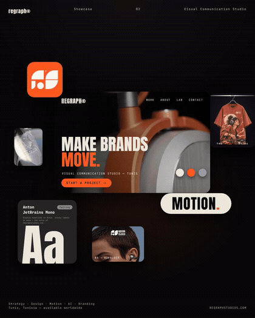
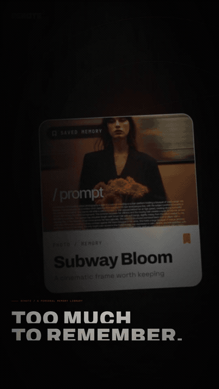
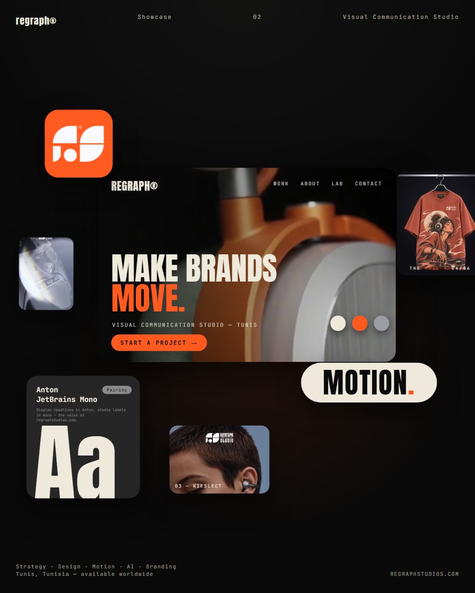
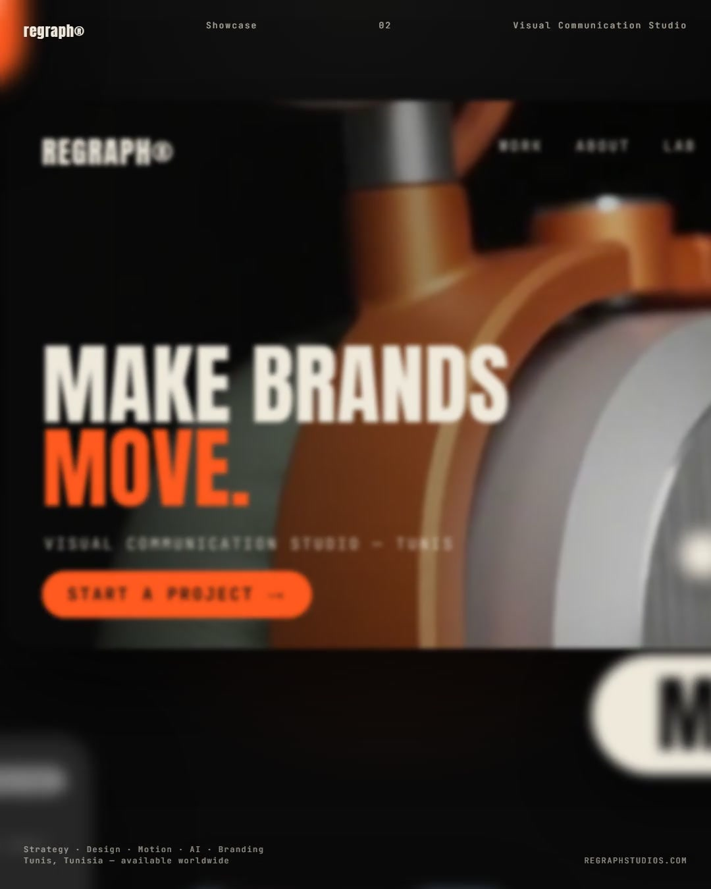
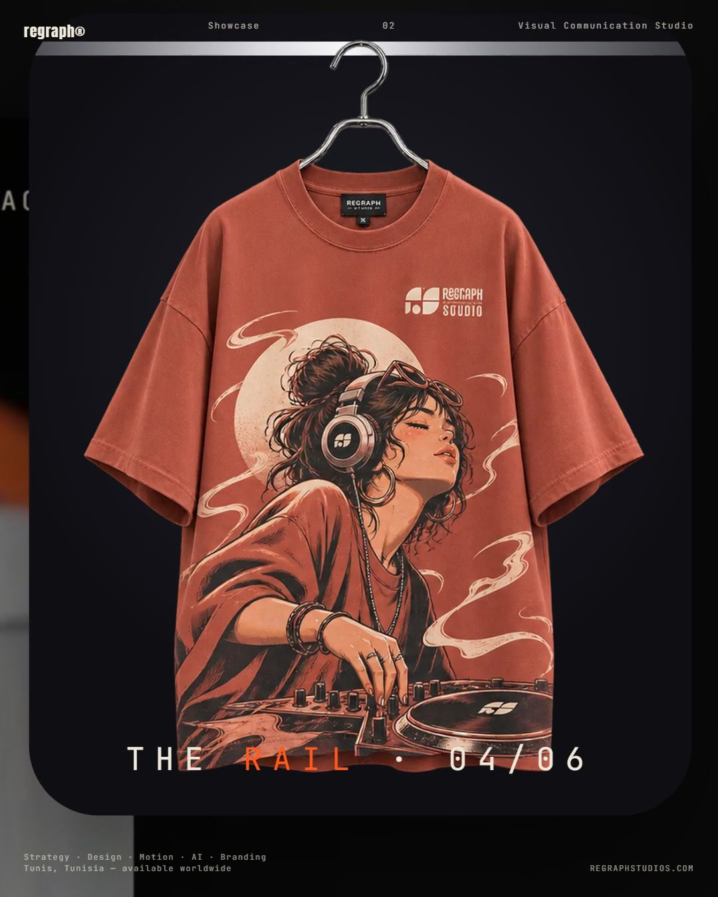
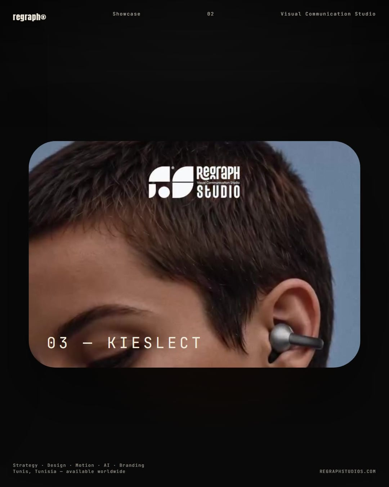

# Regraph Kinetic Lab

**Give your AI agent the eye of a motion director.** Turn a brand brief, rough idea, or visual reference into a clear storyboard and a polished motion video using the tools already in your project.

Made by [Regraph Studio](https://regraphstudios.com) for creators, founders, and teams who want their brand to move with purpose. The workflow is brand-agnostic: it adapts to your identity, audience, language, and production stack instead of forcing one house style.

## See the motion

<table>
  <tr>
    <th>Regraph Studio brand loop · 10 sec</th>
    <th>ReNote product promo · 15 sec</th>
  </tr>
  <tr>
    <td></td>
    <td></td>
  </tr>
</table>

*Both clips were supplied by Regraph Studio as visual examples. They show the creative range this skill can help plan; they are not claimed as outputs generated by the skill.*

### Frames from the loop

<p align="center">
  
  
  
  
</p>

## What it helps you make

- Brand and product promos, launch reels, explainers, title sequences, and social videos.
- Kinetic typography, editorial product reveals, interface motion, 2.5D depth, and footage-led edits.
- Storyboards, reference breakdowns, revisions, or a production-ready prompt for another video agent.
- Multilingual layouts, including right-to-left Arabic, Hebrew, Persian, and Urdu.

## How it works

1. **Understand the brief** — inspect your brand, audience, assets, video project, and target platform.
2. **Find the visual direction** — research Prompt Motion or analyze your reference, then explain what is observed and what is inferred.
3. **Plan the story** — build a timed beat sheet with clear copy, purposeful transitions, and readable typography.
4. **Make it in your stack** — use the project's existing tools and keep every brand choice grounded in your brief.
5. **Review the actual video** — inspect the frames and playback, fix visible issues, and report what was verified.

You can stop at any stage: ask for reference analysis, a storyboard, a prompt handoff, or a complete build. The skill does not grant tools or permissions; browsing, editing, and rendering depend on your agent and environment.

## Install

Install for the current project with [Skills CLI](https://github.com/vercel-labs/skills):

```sh
npx skills add medtarektazarki-dev/regraph-kinetic-lab --skill regraph-kinetic-lab
```

For Antigravity, install directly with:

```sh
npx skills add medtarektazarki-dev/regraph-kinetic-lab --skill regraph-kinetic-lab --agent antigravity
```

The project-local location is `.agents/skills/regraph-kinetic-lab/`. Claude Code is also supported with `--agent claude-code`. Other agents may use their own supported skill directory. If the skill is not picked up, refresh the agent or open `SKILL.md` directly.

## Try it

```text
Make a 15-second launch reel for our new product. Inspect our brand and current video project, find a fitting visual reference, then storyboard, build, and review the final video.
```

```text
Analyze this reference and create an original Arabic kinetic-typography storyboard. Do not edit or render anything yet.
```

```text
Turn this brief into a detailed production prompt for another video agent. Keep it brand-aware and include timing, typography, transitions, and delivery specs.
```

## What's inside

- `SKILL.md` — the main motion-director workflow and activation guidance.
- `references/` — on-demand playbooks for reference research, typography, motion craft, storyboards, audio, delivery, and review.
- `assets/` — brief, storyboard, beat-sheet, and delivery-report templates.
- `scripts/` — beat timing validation and optional FFmpeg/FFprobe review helpers.

The helper scripts are optional. FFmpeg and FFprobe are only needed for automated frame extraction and technical video checks; manual review fallbacks are included.

## FAQ

**Does this require Remotion?** No. The skill inspects the existing project and follows its current video stack. Remotion guidance is used when the project already uses Remotion.

**Does it require browser access?** Only for live reference research. If browsing is unavailable, it can use a reference supplied by you or proceed from your written direction.

**Will it automatically render or publish?** Rendering depends on the tools available and the requested deliverable. Publishing is never implied by installing the skill.

**Does it copy the reference video?** No. It studies design principles such as pacing, hierarchy, and transition logic, then adapts them into an original direction for your brand.

**Can I use it for client work?** Yes. The skill and its source materials are MIT-licensed. Showcase GIFs and images are excluded from that license; see [LICENSE](LICENSE).

## Make it better with us

Try it on a real idea. If it helps, **star the repo** and share a short note or a link to what you made. Feedback, issue reports, and contributions help us improve it for every creator. For custom motion work, visit [Regraph Studio](https://regraphstudios.com).

- [Star Regraph Kinetic Lab](https://github.com/medtarektazarki-dev/regraph-kinetic-lab/stargazers)
- [Share feedback or report an issue](https://github.com/medtarektazarki-dev/regraph-kinetic-lab/issues)
- [Visit Regraph Studio](https://regraphstudios.com)

## License

The skill, documentation, scripts, and text templates are available under the [MIT License](LICENSE). The showcase GIFs and images are excluded and remain with their respective rights holders; do not reuse them without permission.
